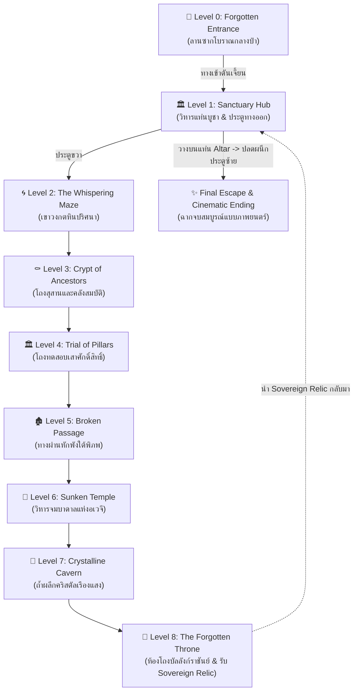

# 🗝️ DUNGEON MYSTERY MAZE (วงกตปริศนาดันเจี้ยนโบราณ)


> **DUNGEON MYSTERY MAZE** เป็นเกมผจญภัยแนวสำรวจดันเจี้ยน 3 มิติ (3D Dungeon Exploration & Puzzle Adventure) พัฒนาด้วย **Godot Engine 4.7** ผู้เล่นจะได้รับบทเป็นนักผจญภัยที่ต้องดำดิ่งลงสู่เขาวงกตใต้พิภพโบราณ 9 ระดับชั้น เพื่อค้นหา **"The Sovereign Relic"** (คทาและตราประจำองค์ราชันย์) จากห้องบัลลังก์ชั้นลึกสุด นำกลับมาประดิษฐานบนแท่นบูชาศักดิ์สิทธิ์เพื่อปลดผนึกประตูทางออกและหลบหนีสู่ผิวดิน

---

## 📖 เนื้อเรื่องย่อ (Story & Lore)

ลึกลงไปใต้ผืนป่าโบราณที่สาบสูญ มีซากปรักหักพังแห่งอาณาจักรโบราณ **Eldoria** ซ่อนตัวอยู่ ประตูทางออกสู่โลกภายนอกถูกสะกดด้วยมนตราโบราณที่ไม่มีผู้ใดเปิดได้ หนทางเดียวที่จะทำลายผนึกมหาเวทคือการเดินทางผ่านเขาวงกต 9 ด่านลงไปยัง **The Forgotten Throne (Level 8)** เพื่อนำ **Sovereign Relic** กลับมาประดิษฐาน ณ **Altar of the Sovereign (Level 1)** แสงแห่งราชันย์จะสลายผนึกประตูใหญ่ นำพาอิสรภาพกลับคืนสู่นักผจญภัย

---

## 🗺️ แผนผังการเดินทาง 9 ด่าน (Dungeon Progression)



---

## 🌟 จุดเด่นและระบบสำคัญ (Key Features)

### 1. 🎮 Dual Perspective (มุมมองบุคคลที่ 1 และ 3)
* สามารถสลับมุมมองได้อย่างราบรื่นตลอดเวลาด้วยปุ่ม `V`
* **First-Person:** สมจริง ดื่มด่ำกับบรรยากาศความลึกลับของทางเดินแคบๆ
* **Third-Person:** มุมมองกว้าง มองเห็นท่าทางแอนิเมชันของตัวละครและการเคลื่อนไหวรอบตัว

### 2. 🧩 Puzzle & Relic Quest System (ระบบภารกิจและแท่นบูชา)
* **Sovereign Relic:** วัตถุโบราณชิ้นเอกที่ประดิษฐานอยู่ใน Level 8
* **Altar of the Sovereign:** แท่นบูชาหินโบราณกลาง Level 1 เมื่อนำ Relic มาวางจะเกิดแสงรัศมีสีทอง ปลดผนึกประตูหลบหนี
* **Reflector Pedestals & Element Crystals:** แท่นสะท้อนแสงและผลึกพลังงานธาตุใน Level 7
* **Pressure Plates & Ancient Buttons:** แผ่นเหยียบและปุ่มสวิตช์กลไกควบคุมประตูลับ

### 3. 🚪 Interactive Door Network (เครือข่ายประตูและการเชื่อมโยง)
* ประตูไม้หมุนเปิดนุ่มนวลด้วยแอนิเมชัน Tween พร้อมบานพับและเสียง SFX
* ประตูแต่ละบานมีป้ายบอกทิศทางชัดเจน เช่น `[E] Enter Level 2`, `[E] Return to Sanctuary`
* **Final Escape Door (ประตูซ้าย Level 1):**
  * ยังไม่มี Relic: ปิดผนึกแน่นหนา `[E] Sealed Sanctuary Gate`
  * มี Relic ในตัว: แจ้งเตือนให้นำไปวางที่แท่นบูชาก่อน `[E] Sealed (Place Relic on Altar)`
  * วาง Relic บนแท่นแล้ว: ปลดผนึกเป็นสีเขียว `[E] Escape (Exit Sanctuary)` เมื่อกด `E` หรือเดินผ่านช่องประตู ประตูจะเปิดออกพร้อมเปลี่ยนเข้าสู่ฉากจบ **Ending Cutscene** ทันที

### 4. 🔊 Dynamic Audio & Atmosphere (ระบบเสียงอัจฉริยะ)
* **Adaptive Music & Ambient:** เพลงประกอบและเสียงสภาพแวดล้อมเปลี่ยนไปตามด่าน (ป่า, ถ้ำหิน, น้ำบาดาล, โถงวิหาร)
* **3-Tier Footsteps:** เสียงฝีเท้าเปลี่ยนตามการเคลื่อนไหว (เดินปกติ, วิ่งเร็ว, ย่องเบา)
* **Positional & Sensory SFX:** เสียงสลักกลไก, ประตูเปิด, หีบสมบัติ, กับดัก และเสียงแจ้งเตือนข้อความ

### 5. 🛡️ Traps & Survival (ระบบกับดักและการเอาชีวิตรอด)
* กับดักหนามแหลมพุ่งจากพื้น (Spike Traps)
* กับดักลูกดอกโบราณ (Dart Traps)
* กับดักคลื่นพลังงานผลึก (Crystal Pulse Traps)
* ระบบเกิดใหม่ทันทีที่จุด Spawn ล่าสุดเมื่อโดนกับดัก พร้อมเอฟเฟกต์เตือนภัย

---

## 🕹️ ปุ่มควบคุม (Controls)

| ปุ่ม (Key) | หน้าที่ (Action) | รายละเอียด |
| :--- | :--- | :--- |
| <kbd>W</kbd> <kbd>A</kbd> <kbd>S</kbd> <kbd>D</kbd> | **เคลื่อนที่ (Movement)** | เดินหน้า / ถอยหลัง / ซ้าย / ขวา |
| <kbd>Mouse</kbd> | **หมุนมุมมอง (Look / Aim)** | ปรับมุมกล้องและทิศทางของผู้เล่น |
| <kbd>Space</kbd> | **กระโดด (Jump)** | กระโดดข้ามสิ่งกีดขวางหรือหลบกับดัก |
| <kbd>Shift</kbd> | **วิ่งเร็ว (Sprint)** | เพิ่มความเร็วในการเคลื่อนที่ |
| <kbd>Ctrl</kbd> | **ย่องเบา / ย่อตัว (Crouch / Sneak)** | ลดเสียงฝีเท้าและเคลื่อนที่ช้าลงอย่างระมัดระวัง |
| <kbd>E</kbd> | **มีปฏิสัมพันธ์ (Interact)** | เปิดประตู, สำรวจป้าย, อ่านจารึก, วาง Relic |
| <kbd>V</kbd> | **สลับมุมมอง (Toggle Perspective)** | สลับระหว่างบุคคลที่ 1 (1st Person) และ 3 (3rd Person) |
| <kbd>I</kbd> | **เปิดกระเป๋า (Inventory)** | ตรวจสอบไอเทมและสถานะของ Sovereign Relic |
| <kbd>Esc</kbd> | **เมนูหยุดเกม (Pause Menu)** | เปิดหน้าตั้งค่าเสียง กราฟิก และปุ่มควบคุม |

---

## 🏰 รายละเอียดด่านทั้งหมด (Levels Breakdown)

| ระดับ | ชื่อด่าน | บรรยากาศ & ภารกิจหลัก |
| :---: | :--- | :--- |
| **Level 0** | **Forgotten Entrance** | ลานซากปรักหักพังกลางป่าใหญ่ ระเบียงเสาหินและพุ่มไม้ นำทางสู่ปากทางเข้าวิหาร |
| **Level 1** | **Sanctuary Hub** | วิหารศักดิ์สิทธิ์ จุดเริ่มต้นและจุดสิ้นสุดของเกม เป็นที่ตั้งของแท่นบูชาและประตูลับสู่ผิวดิน |
| **Level 2** | **The Whispering Maze** | ทางเดินวงกตหินแคบ มีซอกหลืบซับซ้อน ทดสอบทิศทางและการนำทาง |
| **Level 3** | **Crypt of the Ancestors** | โถงสุสานบรรพชน หลุมศพหินโบราณ และห้องคลังสมบัติลับ |
| **Level 4** | **Trial of Pillars** | ลานกว้างใต้ดิน มีช่องแสงส่องลงมาจากเพดานหิน และแนวเสาคลาสสิก |
| **Level 5** | **Broken Passage** | ทางผ่านที่พังทลาย ทางเดินแคบและห้องพักทหารโบราณพร้อมกับดักหนาม |
| **Level 6** | **Sunken Temple of the Abyss** | วิหารบาดาลใต้พิภพ พื้นที่กว้างขวาง ปลอดโปร่ง เสียงน้ำหยดและไอชื้น |
| **Level 7** | **Crystalline Cavern** | ถ้ำผลึกคริสตัลเรืองแสง มีแท่นกระจกสะท้อนพลังงานและผลึกมรกต |
| **Level 8** | **The Forgotten Throne** | ห้องโถงบัลลังก์ทองคำใจกลางดันเจี้ยน ที่ประดิษฐานของ Sovereign Relic |

---

## ⚙️ ข้อมูลทางเทคนิคและสถาปัตยกรรม (Technical Architecture)

```
DUNGEON-MYSTERY-MAZE/
├── Assets/                 # ทรัพยากร 3D โมเดล, พื้นผิว, เสียง และแอนิเมชัน
│   ├── Audio/              # ดนตรีประกอบ BGM, SFX และ Ambient soundscapes
│   ├── Button/             # โมเดลและปุ่มสวิตช์กลไก
│   ├── Forest/             # โมเดลต้นไม้ พุ่มไม้ และธรรมชาติภายนอก
│   ├── Main_Character/     # โมเดลตัวละคร Eric พร้อม Rig และโครงกระดูก
│   └── ThirdParty/         # KayKit Dungeon Assets (Modular Architecture)
├── Data/                   # ฐานข้อมูลบทสนทนา (Dialogues & Quest Data)
├── Scenes/                 # ซีนเกมทั้งหมด (Scenes & Prefabs)
│   ├── Button/             # ปุ่มสวิตช์ปริศนา (Red / Blue Buttons)
│   ├── Level/              # ซีนด่านหลักทั้ง 9 ด่าน (level_0 ถึง level_8)
│   ├── Player/             # Player Controller (CharacterBody3D)
│   ├── Props/              # หีบสมบัติ และพร็อพตกแต่ง
│   └── UI/                 # HUD, เมนูหลัก, Pause, คัตซีนจบเกม EndingCutscene
├── Scripts/                # โค้ดเกม GDScript ทั้งหมด
│   ├── GameManager.gd      # Autoload: จัดการสถานะเกม, การเกิด, ข้อมูลเซฟ, ไอเทม
│   ├── audio_manager.gd    # Autoload: ระบบเสียงไดนามิกข้าม Scene
│   ├── final_door.gd       # กลไกประตูทางออกเชื่อมต่อฉากจบเกม
│   ├── relic_altar.gd      # แท่นบูชาสำหรับวาง Sovereign Relic
│   ├── relic_item.gd       # การเก็บไอเทม Sovereign Relic
│   ├── player.gd           # ระบบควบคุมตัวละคร กล้อง ฟิสิกส์ และการเคลื่อนที่
│   └── UI/                 # UI Manager, Dialogue System, Notification, HUD
└── project.godot           # การตั้งค่าระบบหลักของ Godot 4.7 Engine
```

* **Engine:** Godot Engine `v4.7.stable`
* **Physics Engine:** Jolt 3D Physics (แม่นยำสูง ลื่นไหล ไม่มีการทะลุขอบกำแพง)
* **Rendering Method:** GL Compatibility (รองรับคอมพิวเตอร์หลากหลายสเปกและ Web Browser)
* **Viewport Resolution:** 1920x1080 (Canvas Items Stretch Mode)

---

## 🚀 วิธีการเปิดและเล่นเกม (Getting Started)

### วิธีที่ 1: เล่นผ่าน Godot Engine (Editor)
1. ติดตั้ง **[Godot Engine 4.7](https://godotengine.org/download/)**
2. เปิดโปรแกรม Godot Engine แล้วเลือก **Import**
3. เลือกไฟล์ `project.godot` ในโฟลเดอร์นี้
4. กดปุ่ม **Run Project** (<kbd>F5</kbd>) เพื่อเริ่มเล่นเกมได้ทันที!

### วิธีที่ 2: รันผ่าน Godot Console / Command Line
```powershell
# รันเกมเต็มจอแบบปกติ
godot.exe --path .

# หรือรันเข้าสู่หน้าเมนูหลักโดยตรง
godot.exe --path . Scenes/UI/SplashScreen.tscn
```

---

## 🏆 เงื่อนไขการชนะเกม (Victory Condition)

1. ออกเดินทางจาก **Level 0** ไปจนถึงห้องบัลลังก์ **Level 8**
2. กด `E` เก็บ **Sovereign Relic** ขึ้นมา
3. เดินทางย้อนกลับมาที่ **Level 1 (Sanctuary Hub)**
4. กด `E` วาง Sovereign Relic ลงบน **Altar of the Sovereign** (กลางห้อง)
5. เดินไปที่ประตูด้านซ้าย **Final Door** แล้วกด `E` หรือเดินผ่านช่องประตู
6. รับชมฉากจบภาพยนตร์ **Ending Cutscene** และเข้าสู่หน้า **Game Complete!**

---

<div align="center">
  <b>DUNGEON MYSTERY MAZE</b> — Craft with Passion for Adventure & Mystery.<br/>
  <i>"May the light of the Sovereign guide your path through the darkness."</i>
</div>
